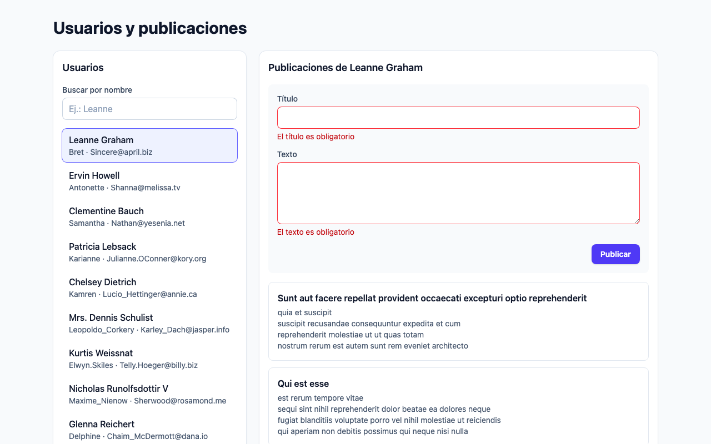

# users-list

App en React + TypeScript que usa la API pública de [JSONPlaceholder](https://jsonplaceholder.typicode.com):

- lista de usuarios con búsqueda por nombre;
- las publicaciones del usuario elegido;
- un formulario validado para crear publicaciones nuevas;
- estados de carga y error visibles en cada paso.



## Cómo ejecutarlo

Requisitos: Node.js 22 o superior y npm.

```bash
npm ci          # instalar dependencias
npm run dev     # app en http://localhost:5173
npm test        # tests (no necesitan conexión: la API está simulada)
```

| Script                 | Qué hace                                                       |
| ---------------------- | -------------------------------------------------------------- |
| `npm run dev`          | Servidor de desarrollo                                         |
| `npm test`             | Ejecuta los tests una vez (`npm run test:watch` en modo watch) |
| `npm run lint`         | ESLint con reglas de tipos estrictas, 0 avisos permitidos      |
| `npm run typecheck`    | Comprobación de tipos                                          |
| `npm run format:check` | Comprueba el formato con Prettier (`npm run format` lo aplica) |
| `npm run build`        | Build de producción en `dist/`                                 |

La CI de GitHub Actions ejecuta lint, typecheck, formato, tests y build en cada PR.

## Estructura

```text
src/
├── api.ts                  # única puerta a la API: tipos, fetch y errores
├── hooks.ts                # hooks de datos (TanStack Query) y publicaciones creadas en la sesión
├── utils.ts                # lógica pura: filtro por nombre y validación del formulario
├── App.tsx                 # layout y usuario seleccionado
├── components/
│   ├── ui/form.tsx         # Button, TextField, TextAreaField (reutilizables)
│   ├── ui/display.tsx      # Card, StatusMessage, ErrorMessage (reutilizables)
│   ├── UsersPanel.tsx      # buscador y lista de usuarios
│   ├── PostsPanel.tsx      # publicaciones del usuario
│   └── PostForm.tsx        # formulario de nueva publicación
└── test/                   # MSW, helpers y 19 tests en 4 archivos
```

## Decisiones

- **Vite y no Next.js.** Es una sola pantalla que funciona entera en el navegador contra una API pública: no hay SEO, rutas ni secretos que justifiquen un servidor. Vite es React puro, con menos configuración, y Vitest reutiliza la misma.
- **Una sola puerta a la API.** Solo `api.ts` conoce la URL y llama a `fetch`. Los componentes consumen hooks de `hooks.ts` y nunca hacen peticiones directamente.
- **TanStack Query para los datos remotos.** Resuelve los estados de carga y error, el reintento y la caché. Las publicaciones se guardan en caché por usuario (clave `['posts', userId]`), así que una respuesta lenta de un usuario anterior nunca sustituye a las del actual. Hacerlo a mano con `useEffect` es fácil de hacer mal.
- **Publicaciones creadas en un estado aparte.** JSONPlaceholder no guarda nada: si se piden de nuevo las publicaciones, la nueva no está. Si la insertara en la caché de TanStack Query, desaparecería en el siguiente refetch (por ejemplo, al pulsar "Reintentar"). Por eso viven en `useCreatedPosts`, agrupadas por usuario, y se muestran primero. Duran mientras no se recargue la página.
- **Ids locales negativos.** La API responde siempre `id: 101`, así que dos publicaciones nuevas tendrían la misma `key`. Cada una recibe un id local negativo (-1, -2…), que nunca coincide con los del servidor (1 a 100).
- **La publicación va al usuario para el que se envió.** El callback que la guarda está en las opciones de `useMutation`, no en `mutate`, así que funciona aunque cambies de usuario mientras se envía.
- **Componentes reutilizables agrupados.** Las piezas genéricas están en dos archivos según su función: controles de formulario y elementos de presentación. Hay un archivo por pantalla, no uno por cada componente pequeño.
- **Máximo 150 líneas por archivo**, comprobado por la regla `max-lines` de ESLint. Cuando `ui.tsx` llegó al límite, se dividió por responsabilidad.
- **Tests de comportamiento con MSW.** Los tests renderizan la app real y simulan la API a nivel de red, así que prueban lo que ve el usuario, no los mocks. Buscan los elementos por rol y por etiqueta, como un lector de pantalla. La lógica pura (filtro y validación) tiene tests unitarios.
- **Accesibilidad.** Los estados de carga y vacío usan `role="status"` y los errores `role="alert"`. Los campos tienen etiqueta y su error asociado con `aria-describedby`. Al enviar el formulario con errores, el foco va al primer campo inválido. El usuario seleccionado se marca con `aria-pressed`.
- **TypeScript 6.0 y no 7.** `typescript-eslint` todavía no es compatible con la 7, y el lint con tipos merecía más la pena.
- **Git.** Ramas `feat/*`, `chore/*` y `docs/*` con PR a `develop`, y un PR de `develop` a `main` cada 5 PRs. Todo se fusiona con merge commit, no squash, para que se vea cada commit.

## Qué haría con más tiempo

- **Validar las respuestas de la API con Zod**: ahora se confía en que tengan la forma esperada.
- **React Hook Form + Zod** si el formulario creciera. Para dos campos obligatorios, una función pura es suficiente.
- **Optimistic updates**: mostrar la publicación al instante y retirarla si falla.
- **Guardar las publicaciones creadas en `localStorage`** para que sobrevivan a una recarga.
- **Búsqueda sin tildes** (`normalize('NFD')`) y también por usuario o correo.
- **Tests end-to-end con Playwright** contra la app real, además de los de integración.
- **Desplegar en Vercel** con previews por PR.
- **Husky + commitlint** para forzar Conventional Commits en local.

## Cómo usé la IA

Trabajé con **Claude Code** y [Spec Kit](https://github.com/github/spec-kit), en este orden: especificación → aclaraciones → plan → tareas → implementación. Cada paso dejó un documento que revisé antes de pasar al siguiente.

**Qué le pedí**

- Convertir el enunciado en una especificación con historias de usuario, requisitos y casos límite.
- Proponer el stack y la arquitectura, y dividir el trabajo en tareas y PRs pequeños.
- Implementar las tareas escribiendo primero los tests y haciendo un commit por paso, con PRs a `develop` y releases a `main`.
- Revisar la interfaz en móvil y escritorio antes de cerrar.

**Qué acepté**

- Los casos límite que identificó en la especificación: respuestas que llegan desordenadas al cambiar rápido de usuario, el `id: 101` repetido, el doble envío, y que la publicación se asigne al usuario correcto si cambias durante el envío.
- TanStack Query, el estado aparte para las publicaciones creadas y los ids negativos.
- MSW para los tests y el flujo con merge commits.

**Qué corregí o decidí yo**

- **La estructura.** El primer plan usaba carpetas por funcionalidad, con un archivo por componente y por hook (unos 25 archivos). Lo cambié a: componentes reutilizables agrupados, un único archivo para la API, los hooks aparte y un máximo de 150 líneas por archivo.
- **Vite en lugar de Next.** El README inicial del repo decía Next; lo confirmé después de comparar las dos opciones.
- **El idioma.** La interfaz y el README en español; el código, los commits y los PRs en inglés.
- **`useCallback` innecesarios.** La IA había envuelto en `useCallback` las funciones de `useCreatedPosts`. Al preguntarle por qué, reconoció que nadie compara esas referencias: no hay `React.memo` ni dependencias de efectos. Los quité.

**Qué hubo que corregir durante la implementación**, porque la realidad no coincidía con el plan:

- La plantilla actual de Vite trae oxlint y TypeScript 7 y no activa `strict`. Se mantuvo ESLint con reglas de tipos, se fijó TypeScript 6.0 y se activaron `strict` y `noUncheckedIndexedAccess` a mano.
- MSW 3 renombró una opción (`onUnhandledRequest` pasó a `onUnhandledFrame`). Lo detectó el typecheck.
- Un test buscaba el botón del usuario por su nombre exacto, pero su nombre accesible incluye también el usuario y el correo. Corregí el test en lugar de quitar ese contexto al lector de pantalla.
- Al revisar en móvil, elegir un usuario no mostraba ningún cambio visible: las publicaciones quedaban unos 900 px más abajo. Lo resolví dando a la lista de usuarios su propio scroll.

El historial de commits y la descripción de cada PR cuentan el proceso paso a paso.
